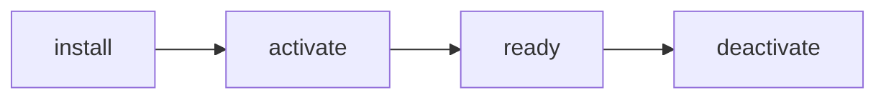

# 插件系统设计草案

> 插件应当扩展能力，而不是绕过约定。

## 00. 目标与非目标

### 目标

- 允许第三方注册<mark>命令</mark>、渲染器与设置面板。
- 插件只能在被显式授予的作用域内读取文档。
- 卸载插件后，其行为必须完全消失。

### 非目标

- **不提供**文件系统与网络直连能力。
- **不做**自动更新与远程代码分发。
- **不支持**插件间互相依赖解析。

## 01. 生命周期



插件生命周期由宿主严格控制，<comment id="c-lifecycle">每个阶段都必须可回滚</comment>。

```ts
export interface PluginContext {
  readonly id: string
  commands: {
    register(command: Command): Disposable
    execute(id: string): Promise<void>
  }
  workspace: {
    getActiveDocument(): DocumentSnapshot | null
    onDidChangeDocument(listener: Listener): Disposable
  }
  ui: {
    addToolbarItem(item: ToolbarItem): Disposable
    addSettingsPanel(panel: SettingsPanel): Disposable
  }
  storage: {
    get<T>(key: string): T | undefined
    set<T>(key: string, value: T): void
  }
  logger: Logger
}
```

### 1.1 注册入口

```ts
import type { MarkPagePlugin } from '@markpage/sdk'

export default {
  id: 'focus-mode',
  name: '专注模式',
  version: '1.0.0',
  activate(context) {
    const disposable = context.commands.register({
      id: 'focus.toggle',
      title: '切换专注模式',
      keybinding: 'Ctrl+Shift+F',
      run: () => context.workspace.toggleUi('focus'),
    })
    context.subscriptions.push(disposable)
  },
  deactivate() {
    // 宿主会先清理本插件注册的全部资源，此处只做内部状态收尾。
  },
} satisfies MarkPagePlugin
```

### 1.2 渲染器扩展

插件可以注册自定义节点渲染器，但**只能作用于自定义标签**：

```ts
context.renderers.register({
  tagName: 'mp-mermaid',
  render(node, renderChildren) {
    return <MermaidBlock source={String(node.properties.code)} />
  },
})
```

## 02. 权限模型

| 能力 | 默认 | 需要授权 | 说明 |
| :--- | :---: | :---: | :--- |
| 读取当前文档 | ✅ | — | 仅返回快照副本 |
| 写入当前文档 | ❌ | `write` | 需用户在提示条确认 |
| 注册命令 | ✅ | — | ID 必须带插件前缀 |
| 网络请求 | ❌ | `network` | 首版不开放 |
| 访问本地存储 | ✅ | — | 命名空间隔离 |

> [!warning]
> 任何写入操作都必须在 UI 上可撤销，且不允许静默执行。

## 03. 错误处理

插件抛出的异常会被宿主捕获，不影响主进程：

```bash
[markpage][plugin:focus-mode] Command "focus.toggle" failed
  → TypeError: cannot read property 'toggleUi' of undefined
  → plugin disabled for this session
```

连续失败三次的插件会被禁用，并在设置面板中标记。

## 04. 待办

- [x] 定义 `PluginContext` 接口
- [x] 实现命令注册与销毁
- [ ] 实现设置面板挂载点
- [ ] 增加插件沙箱隔离评估
- [ ] 编写 SDK 类型声明与文档

## 05. 验收标准

1. 安装示例插件后，工具栏出现对应按钮。
2. <span style="color:#6750a4">卸载后无任何残留 DOM 与命令</span>。
3. 单个插件崩溃不影响其他插件与编辑器。

> [!note]
> RFC 状态：待评审。评审时间 2026-10-28。

> [!comment c-lifecycle]
> **架构组** · 2026-10-25 21:40
> 「可回滚」应明确为：deactivate 后不残留 DOM、命令与监听器。
>
> **晚坷** · 2026-10-25 22:05
> 同意，我会在验收标准里补一条具体的 DOM 检查。
